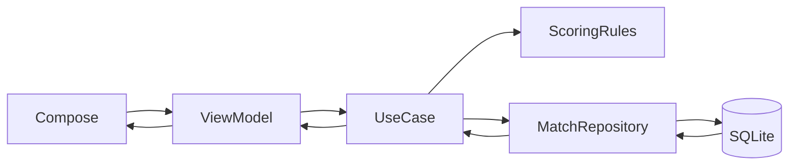
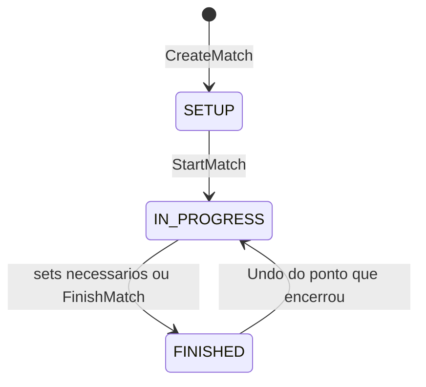

# MatchPoint (Volley Score)

Aplicativo Android de placar para partidas reais de vôlei. O projeto demonstra desenvolvimento Android moderno: Kotlin, Jetpack Compose, MVVM, Clean Architecture, persistência local e testes de regras de negócio.

Nome técnico do módulo: `br.com.matchpoint`. Nome visível no launcher: **Volley Score**.

---

## Objetivo

Oferecer um placar utilizável durante o jogo — configurar times e elenco, marcar pontos por jogador, controlar sets e saque, desfazer o último ponto e encerrar a partida — com persistência imediata no dispositivo.

O app também serve como peça de portfólio: as regras de vôlei ficam isoladas no Domain, a UI só observa estado e dispara eventos, e a persistência não conhece “set acaba em 25”.

---

## Funcionalidades

Implementadas na versão atual:

- **Home:** lista de partidas (rascunho, em andamento e finalizadas), estado vazio, carregamento, erro com nova tentativa, atalho para nova partida.
- **Configuração:** nomes dos times, formato em 3 ou 5 sets, jogadores por time. Confirmação cria a partida, persiste o elenco e abre o placar.
- **Placar ao vivo:** nomes, placar do set, placar de sets, indicador de saque, ponto atribuído a um jogador, desfazer último ponto, finalizar partida. A tela permanece ligada durante o jogo.
- **Regras de pontuação:** rally scoring, vitória por 2 (quando configurada), set decisivo com meta própria, encerramento automático ao atingir os sets necessários.
- **Persistência local:** a partida sobrevive à rotação de tela e ao encerramento do processo.

Não fazem parte desta versão: pagamentos, rede, autenticação, estatísticas na UI, tela de detalhe/súmula, cadastro reutilizável de times, rotação em quadra, substituições ou tipos de ponto (ace, bloqueio, erro).

---

## Tecnologias

| Área | Stack |
|------|--------|
| Linguagem | Kotlin |
| UI | Jetpack Compose, Material 3 |
| Arquitetura | MVVM + Clean Architecture |
| Injeção | Koin |
| Assíncrono | Coroutines, StateFlow |
| Navegação | Navigation Compose |
| Persistência | Room |
| Testes | JUnit, Mockito, Turbine, kotlinx-coroutines-test |

---

## Arquitetura

Três camadas em um único módulo `app`. A seta de dependência aponta para o Domain.

```text
Presentation  →  Domain  ←  Data
     UI/VM         regras         Room
```

- **Presentation:** Compose, ViewModels, `UiState` imutável. Não acessa Room. Não decide quem ganha o set.
- **Domain:** modelos, `MatchRepository` (contrato), use cases, `ScoringRules`. Sem Android, Compose ou Room.
- **Data:** entidades, DAOs, mappers Entity ↔ Domain, `MatchRepositoryImpl`. Sem regra de pontuação.

Injeção: `MatchPointApp` inicia o Koin com `presentationModule`, `domainModule` e `dataModule`.



---

## Estrutura de diretórios

```text
app/src/main/java/br/com/matchpoint
  app/                 MatchPointApp, MainActivity
  di/                  Módulos Koin
  presentation/
    navigation/        Rotas e NavHost
    home/              Lista de partidas
    matchsetup/        Nova partida
    scoreboard/        Placar ao vivo
    theme/
  domain/
    model/
    repository/        Interface
    usecase/
    scoring/           ScoringRules
  data/
    local/db|dao|entity|mapper
    repository/        MatchRepositoryImpl
app/src/test/java/...  Testes unitários
```

---

## Fluxo de processamento de pagamentos

O MatchPoint **não processa pagamentos**. Não há gateway, cobrança, webhook nem conciliação financeira.

O fluxo equivalente no produto é o **processamento de um ponto** (e o de finalizar a partida), ponta a ponta:

1. A UI dispara `onPlayerPoint(playerId)` ou `onFinishMatch()`.
2. O `ScoreboardViewModel` chama `RegisterPointUseCase` ou `FinishMatchUseCase`.
3. O use case lê a partida no repositório. Falhas de regra viram `DomainResult.Failure` (`MatchNotFound`, `PlayerNotFound`, `MatchAlreadyFinished`, etc.).
4. Em um ponto, `ScoringRules.registerPoint` anexa o evento e **reconstrói** placar, saque, sets e status (`replay`).
5. `MatchRepositoryImpl` grava o agregado em transação Room (partida, times, jogadores, sets e pontos).
6. `ObserveMatchUseCase` emite o novo snapshot por `Flow`.
7. O ViewModel mapeia para `Active` ou `Finished`. A UI recompõe.

Não há estado de placar só em memória: a fonte persistida é a lista de pontos mais as regras.

---

## Máquina de estados

### Partida (`MatchStatus`)



| Estado | Comportamento |
|--------|----------------|
| `SETUP` | Permite editar nomes, regras e elenco. Não registra ponto. |
| `IN_PROGRESS` | Aceita ponto, undo e finalização. Elenco e regras travados. |
| `FINISHED` | Não registra ponto. Undo do último ponto pode reabrir a partida. |

Transições inválidas não lançam exceção: o Domain devolve `DomainResult.Failure`.

### Set

Um set está aberto (`winnerTeamId == null`) ou encerrado. Encerrar o set sem encerrar a partida abre o próximo em 0–0. O set decisivo usa `pointsToWinLastSet` quando ambos têm `setsToWin - 1` sets.

### UI do placar (`ScoreboardUiState`)

`Loading` → `Active` (partida em andamento) ou `Finished` (encerrada) ou `Error`. Falha pontual (jogador inválido) permanece em `Active` com `actionError`, sem apagar o placar.

A Home usa `Loading`, `Empty`, `Content` e `Error`.

---

## Estratégia de idempotência

Não há chave de idempotência de requisição HTTP: o app é offline e local.

O que o código garante:

- Cada ponto recebe um **id único** (`IdGenerator` / UUID) no momento da gravação.
- O placar não é um contador solto: `ScoringRules.replay` recalcula o estado a partir da **lista ordenada de pontos**. Gravacão e leitura não divergem por “dois campos de placar”.
- O upsert do agregado ocorre em **transação Room**, para não persistir set sem o ponto correspondente.
- Operações inválidas no mesmo estado (ponto em partida já encerrada, undo sem pontos) são rejeitadas com `DomainResult`, não aplicadas de novo.

O que **não** está implementado: deduplicação de clique duplo no botão de ponto. Dois toques válidos geram dois pontos. A compensação prevista é **desfazer o último ponto**.

---

## Tratamento de timeout e consulta de status

Não há chamada de rede nem fila de pagamento, portanto não há timeout de gateway nem polling de transação.

A consulta de status da partida é **reativa e local**:

- `MatchDao.observeAggregate` / `observeAllAggregates` expõem `Flow`.
- Home e placar observam esse fluxo (`ObserveMatchHistoryUseCase`, `ObserveMatchUseCase`).
- Se o `Flow` da Home falhar, o estado vai para `Error` e **Tentar novamente** reinscreve a observação.
- Após kill do processo, o status volta do SQLite; o placar reabre a partida pelo `matchId`.

Erros de negócio (partida inexistente, elenco inválido, partida não iniciada) são modelados em `DomainError` e traduzidos para mensagem na Presentation (`toUiMessage()`), sem crash.

---

## Testes automatizados

Testes unitários em `app/src/test` (JUnit). Sem UI tests no recorte atual.

| Suíte | Foco |
|-------|------|
| `ScoringRulesTest` / `VolleyballMatchRulesTest` | Ponto, saque, vitória por 2, set decisivo, undo, estados inválidos, fim de jogo |
| `MatchUseCasesTest` / `MatchInvalidStateUseCaseTest` | Criar, iniciar, elenco, setup travado após o início; Turbine nos `Flow` |
| `MatchViewModelTest` | `ScoreboardViewModel`: loading, ponto, erro, fim de set, fim de partida; Mockito no repositório, Turbine no `StateFlow` |

```bash
./gradlew testDebugUnitTest
```

No Windows: `.\gradlew.bat testDebugUnitTest`.

---

## Como executar

Requisitos: Android Studio recente, JDK 17+ (o wrapper usa Gradle 9.6), dispositivo ou emulador com API 24 ou superior.

```bash
# Compilar APK de debug
./gradlew assembleDebug

# Instalar e executar pelos testes unitários
./gradlew testDebugUnitTest
```

No Windows, use `gradlew.bat` no lugar de `./gradlew`.

Pelo Android Studio: abrir a pasta do projeto, sync Gradle, Run na `app` (`MainActivity`).

APK gerado em `app/build/outputs/apk/debug/`.
